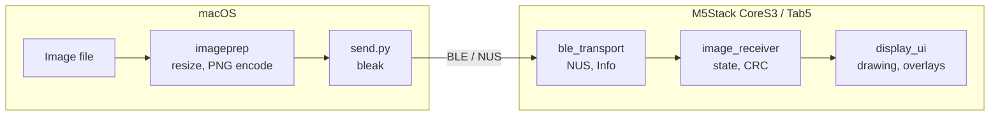
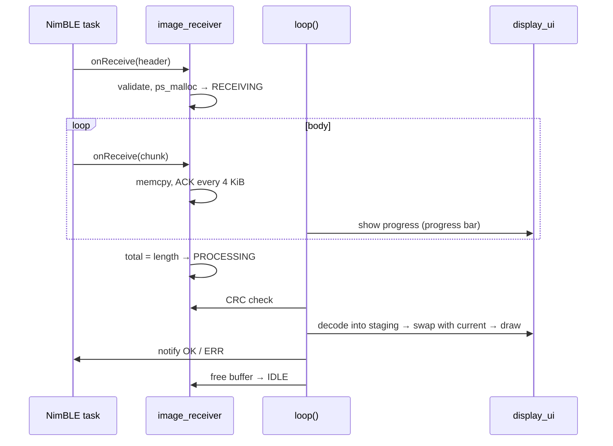

# Design

## 1. Overview

A system that connects from macOS to an M5Stack CoreS3 or Tab5 over BLE, transfers a PNG image and shows it on the screen.

- **Firmware**: runs on the CoreS3 / Tab5, receives images over BLE and shows them
- **Sender**: a Python CLI running on macOS that converts images to PNG of the device's screen size and sends them



See the [protocol](protocol.md) for the communication details.

## 2. Requirements

### 2.1 Functional requirements

| Item | Description |
| --- | --- |
| Communication | Transfer images over the BLE Nordic UART Service (NUS) |
| Image format | PNG of the screen size, decoded on the device |
| Resizing | The sender reads the screen size from the device and fits images to it. The default is `contain` (black padding). The device scales a PNG of another size to fit the screen |
| Display | Show the last image received. The image is kept in memory and a restart clears it |
| Orientation | Fixed landscape (CoreS3: 320×240, Tab5: 1280×720) |
| Idle screen | Show the device name and the BLE connection status |
| During transfer | Overlay a progress bar at the bottom of the screen |
| Errors | Show the error as a toast for a few seconds, then return to the previous image |
| Security | Any Central can connect without pairing |
| Power | The screen stays on at a fixed medium brightness |

### 2.2 Non-functional requirements

| Item | Description |
| --- | --- |
| Image size limit | PNG byte length. CoreS3: 512 KiB, Tab5: 4 MiB |
| Timeout | Discard a transfer after 5 seconds without data |
| Reliability | Verify the transferred data with CRC32. On failure, the sender resends from the start |

## 3. Hardware

| Item | CoreS3 | Tab5 |
| --- | --- | --- |
| SoC | ESP32-S3 | ESP32-P4 (no radio) + ESP32-C6 (wireless co-processor) |
| Bluetooth | BLE 5.0 | BLE 5.0 on the ESP32-C6. The ESP32-P4 runs the NimBLE host and talks HCI to the C6 over SDIO (ESP-Hosted) |
| Display | 320×240, RGB565 | 1280×720 (720×1280 portrait panel, rotated), RGB565 |
| PSRAM | 8 MB | 32 MB |

## 4. Firmware design

### 4.1 Development environment

- PlatformIO with the Arduino framework

| Environment | Board | Platform | BLE library |
| --- | --- | --- | --- |
| `m5stack-cores3` (default) | `m5stack-cores3` | `espressif32` 6.x (Arduino 2.x) | `h2zero/NimBLE-Arduino` |
| `m5stack-tab5` | `m5stack-tab5-p4` | pioarduino `platform-espressif32` 55.x (Arduino 3.3) | BLE library of the Arduino core (NimBLE host over ESP-Hosted) |

- Libraries
  - `m5stack/M5Unified`: display and device control (uses `drawPng` from M5GFX)
  - NimBLE-Arduino does not build for the ESP32-P4 on Arduino 3.3, so the Tab5 uses the BLE library of the Arduino core. Each environment excludes the other library with `lib_ignore`
- `M5VIEW_MAX_LENGTH` (build flag) sets the image size limit. The default is 512 KiB, and the Tab5 environment sets 4 MiB

### 4.2 Source layout

```
src/
├── main.cpp               # setup() / loop(). Module setup and event handling
├── ble_transport.h        # NUS service, Info, advertising, connections, notifications
├── ble_transport_nimble.cpp  # Implementation with NimBLE-Arduino (CoreS3)
├── ble_transport_hosted.cpp  # Implementation with the Arduino core BLE over ESP-Hosted (Tab5)
├── image_receiver.h/.cpp  # Receiver state machine, buffer, CRC32, timeout
└── display_ui.h/.cpp      # Image storage and drawing, idle screen, progress bar, toast
```

### 4.3 Modules

#### ble_transport

- Initializes BLE and registers the NUS service (RX / TX) and the Info characteristic ([protocol §1.4](protocol.md#14-info-characteristic)). `main.cpp` builds the Info value from the screen size and `M5VIEW_MAX_LENGTH`
- Builds the device name `M5-View-XXXX` from the BLE MAC address and advertises it
- Two implementations, picked by `CONFIG_IDF_TARGET_ESP32P4`
  - `ble_transport_nimble.cpp`: NimBLE-Arduino
  - `ble_transport_hosted.cpp`: BLE library of the Arduino core. `BLEDevice::init()` starts ESP-Hosted and connects to the BLE controller on the ESP32-C6. The C6 address is known only after init, so the GAP device name is set again afterwards
- Sets the preferred ATT_MTU to 517 (the Central starts the MTU exchange). Allows one connection at a time
- Interface
  - Callback for RX writes (`onReceive(const uint8_t*, size_t)`)
  - Callback for disconnection
  - Connection status (`isConnected()`)
  - Sending TX notifications (`notify(const char*)`)
- Resumes advertising after disconnection

#### image_receiver

Implements the state machine (`IDLE` / `RECEIVING` / `PROCESSING`) in [protocol §4](protocol.md#4-state-transitions-receiver).

- **Header**: validates the magic and length, then allocates a receive buffer of `length` bytes in PSRAM (`ps_malloc`)
- **Body**: copies data into the buffer with `memcpy` in the RX callback and updates the total byte count and the time of the last write. Each time the total reaches or passes a 4096-byte boundary, notifies `ACK <n>` with that boundary
- **Completion**: when the total reaches `length`, moves to `PROCESSING` and hands over to `loop()`
- **CRC32**: computed in `loop()` after reception with a table-driven software implementation (zlib compatible)
- **Timeout**: `loop()` calls `poll()` regularly. If 5 seconds have passed since the last write in `RECEIVING`, notifies `ERR timeout` and discards the transfer
- **Disconnection**: in `RECEIVING`, frees the receive buffer, returns to `IDLE` and shows the toast `Error: disconnected`. In `PROCESSING`, `loop()` is still using the buffer, so `finish()` frees it when processing completes

#### display_ui

- Rotates the screen to landscape at startup and takes the screen size from it
- Holds two canvases (`M5Canvas`) of the screen size in PSRAM
  - `current`: the image on screen
  - `staging`: the decode target
- **Image update**: decodes the PNG into `staging`, and on success swaps it with `current` and pushes it to the screen. On failure, keeps `current` and the image on screen. A PNG of another size is scaled to fit the screen, keeping the aspect ratio, and centered (`drawPng` with zoom 0)
- **UI scale**: sizes of the text, progress bar and toast are defined for 320 px wide and scaled by `width / 320` (×4 on the Tab5). Large screens use larger fonts so text stays smooth
- **Idle screen**: until an image arrives, shows the device name and the connection status (`Advertising` / `Connected`) on a black background
- **Progress bar**: during a transfer, overlays a bar a few pixels tall at the bottom of the screen. Updates redraw the bar area alone
- **Toast**: on errors, shows a message (e.g. `Error: crc`) at the bottom of the screen for about 3 seconds, then redraws `current` (or the idle screen) to clear it
- Brightness is fixed at 128/255 (medium)

### 4.4 Threads and locking

NimBLE callbacks run on the NimBLE host task, and `loop()` runs on the Arduino main task.

| Work | Context |
| --- | --- |
| Header parsing, buffer allocation, `memcpy`, `ACK` notifications | NimBLE host task (RX callback) |
| CRC check, PNG decoding, drawing, `OK` / `ERR` notifications | `loop()` |
| Timeout checks, UI updates (progress, toast, connection status) | `loop()` |

- The state, the total byte count and the buffer pointer live inside `image_receiver`, guarded by a mutex (`std::mutex`)
- The RX callback copies into the buffer and updates the state. CRC calculation, decoding and drawing happen in `loop()`
- `loop()` polls for state changes (progress, completion, errors, connection status) and reflects them in the UI
- RX writes arriving during `PROCESSING` are discarded

### 4.5 Memory

| Use | Size | Location |
| --- | --- | --- |
| Receive buffer | Up to `M5VIEW_MAX_LENGTH` (`length` bytes) | PSRAM, allocated and freed per transfer |
| Canvas × 2 | CoreS3: 150 KiB × 2, Tab5: 1.8 MiB × 2 | PSRAM, allocated at startup |

### 4.6 Processing flow



## 5. Sender design

### 5.1 Development environment

- Python (managed with `uv`)
- Dependencies: `bleak` (BLE), `Pillow` (image processing)
- Tests: `pytest`

### 5.2 Source layout

```
tools/sender/
├── pyproject.toml
├── send.py               # CLI launcher
├── m5view_sender/        # Package, also used as a dependency by other tools
│   ├── cli.py            # CLI. Argument parsing and sending
│   ├── transfer.py       # BLE connection and transfer (M5ViewClient)
│   ├── protocol.py       # Header building, chunking, notification parsing
│   └── imageprep.py      # Image loading, fitting, PNG encoding
├── samples/              # Images for trying things out
└── tests/
    ├── test_protocol.py
    └── test_imageprep.py
```

### 5.3 CLI

```
uv run send.py IMAGE [--name PREFIX] [--address ADDRESS]
                     [--fit contain|cover|stretch] [--bg #RRGGBB]
```

| Option | Default | Description |
| --- | --- | --- |
| `IMAGE` | (required) | Image file to send, in any format Pillow can read |
| `--name` | `M5-View` | Find the device by name prefix and connect to the first match |
| `--address` | - | Connect to this device (a CoreBluetooth UUID on macOS). Takes precedence over `--name` |
| `--fit` | `contain` | `contain`: shrink to fit and pad / `cover`: enlarge to fill and crop / `stretch`: stretch ignoring the aspect ratio |
| `--bg` | `#000000` | Padding color for `contain` |

- Exit code: `0` on success, `1` if the device is not found, the connection fails, `ERR` arrives or the transfer times out

### 5.4 Modules

#### imageprep

- Opens the image with Pillow, applies the EXIF orientation and converts it to RGB
- Fits it to the given size (default 320×240) according to `--fit` (resampling with `LANCZOS`)
- Encodes it as PNG (`optimize=True`) and returns the bytes

#### protocol

- `build_header(data: bytes, max_length) -> bytes`: builds `"IMG0"` + `length` + `zlib.crc32`
- `parse_info(bytes) -> DeviceInfo`: parses the Info characteristic (`width` / `height` / `max_length`). `DEFAULT_INFO` is the value assumed when the device has no Info characteristic
- `iter_chunks(data, chunk_size)`: splits the body
- `parse_notification(bytes)`: parses `ACK <n>` / `OK` / `ERR <reason>`
- Pure functions independent of BLE, covered by unit tests

#### transfer

`M5ViewClient` keeps the connection open and sends any number of images.

- `connect()`: finds the device with `BleakScanner`, connects with `BleakClient`, reads the Info characteristic into `info` and subscribes to TX notifications. Incoming notifications go into an `asyncio.Queue`
- `send(png)`: sends one image and waits until the device has shown it
  1. Drops notifications left from the previous transfer
  2. Sends the header
  3. Picks the chunk size from `max_write_without_response_size` and sends with `response=False` within each 4096-byte window, waiting for `ACK` at the end of each window
  4. Succeeds on `OK` and fails on `ERR`. Waiting for a reply times out after 10 seconds
- `disconnect()`: disconnects
- Reports every failure as `TransferError`

#### cli

1. Checks that the image file opens
2. Connects with `M5ViewClient`
3. Builds the PNG of the screen size in `info` with `imageprep` (exits with an error before sending if it exceeds `max_length`)
4. Sends while showing progress in the terminal
5. Disconnects when finished

## 6. Testing

| Target | Method |
| --- | --- |
| `protocol` | Unit tests with `pytest` (header format, CRC, chunking, notification parsing, Info parsing) |
| `imageprep` | Unit tests with `pytest` (output size, padding color, PNG encoding) |
| Firmware | Manual tests on the device |

Manual test points (using the images in `tools/sender/samples/`):

- Each `--fit` mode shows the image correctly
- Large images (PNG of a few hundred KiB on the CoreS3, a few MiB on the Tab5) transfer and show correctly
- A PNG of another size (e.g. 320×240 sent to the Tab5) is scaled to fit the screen and centered
- If the sender stops mid-transfer, an error appears after the 5-second timeout and the previous image returns
- If the connection drops mid-transfer, the transfer is discarded, an error appears and the previous image returns
- An invalid header or a CRC mismatch returns `ERR` and shows a toast
- The connection status on the idle screen follows disconnected → connected → disconnected
