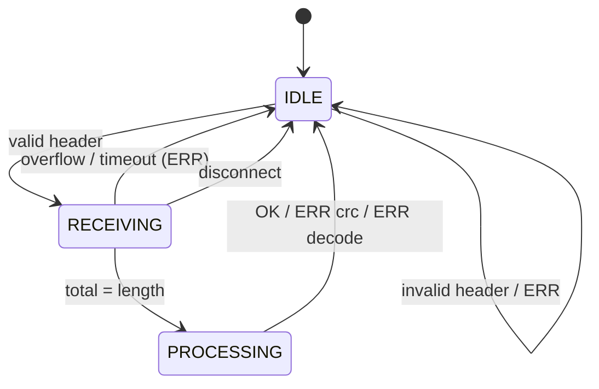
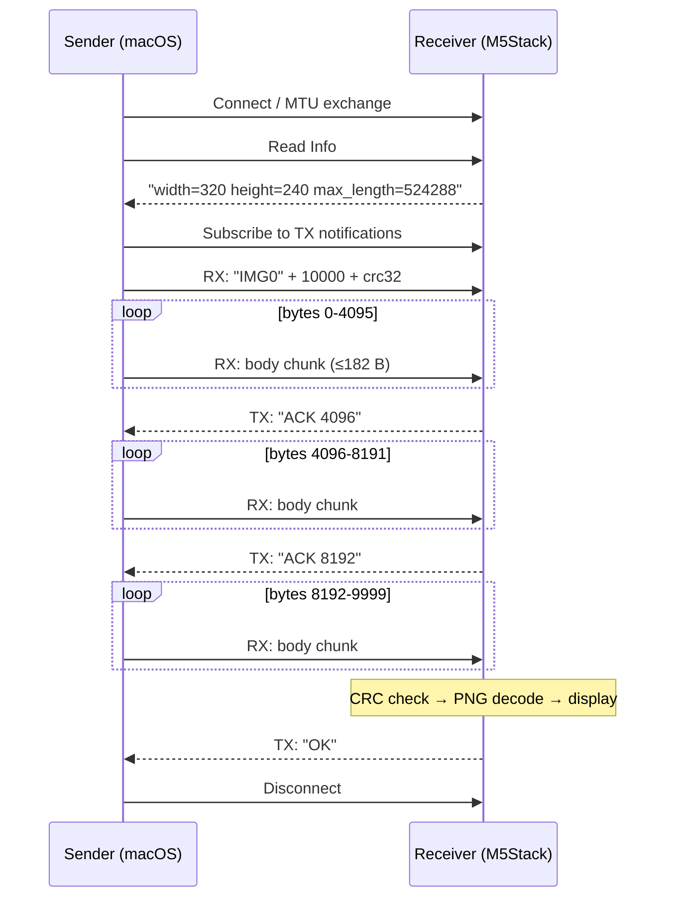

# Protocol

This document defines the protocol for transferring a single PNG image over BLE from macOS (the sender, Central) to an M5Stack CoreS3 or Tab5 (the receiver, Peripheral).

## 1. Transport

### 1.1 GATT service

The protocol uses the Nordic UART Service (NUS), with an added Info characteristic.

| Name | UUID | Properties | Direction |
| --- | --- | --- | --- |
| NUS Service | `6E400001-B5A3-F393-E0A9-E50E24DCCA9E` | - | - |
| RX Characteristic | `6E400002-B5A3-F393-E0A9-E50E24DCCA9E` | Write, Write Without Response | Sender → receiver |
| TX Characteristic | `6E400003-B5A3-F393-E0A9-E50E24DCCA9E` | Notify | Receiver → sender |
| Info Characteristic | `6E400004-B5A3-F393-E0A9-E50E24DCCA9E` | Read | Receiver → sender |

### 1.2 Advertising

- Device name: `M5-View-XXXX`
  - `XXXX` is the lower 2 bytes of the BLE MAC address in uppercase hex (e.g. `M5-View-3FA2`). On the Tab5 it is the address of the ESP32-C6 that runs the BLE controller
- The advertising packet carries the NUS Service UUID, and the scan response carries the device name
- Any Central can connect without pairing (traffic is unencrypted)
- One connection at a time. Advertising stops while connected and resumes after disconnection

### 1.3 MTU

- The receiver prefers an ATT_MTU of 517 (the sender starts the MTU exchange)
- The actual MTU is the negotiated one
- The sender keeps each write at `ATT_MTU - 3` bytes or less

### 1.4 Info characteristic

A read-only ASCII string of space-separated `key=value` items that describes the receiver. The sender reads it after connecting and ignores unknown keys.

| Key | Content | CoreS3 | Tab5 |
| --- | --- | --- | --- |
| `width` | Screen width in pixels (landscape) | `320` | `1280` |
| `height` | Screen height in pixels (landscape) | `240` | `720` |
| `max_length` | Upper limit of the body length `length` in bytes | `524288` (512 KiB) | `4194304` (4 MiB) |

Example: `width=1280 height=720 max_length=4194304`

If the receiver has no Info characteristic, the sender assumes `width=320 height=240 max_length=524288`.

## 2. Messages

All multi-byte integers are little-endian.

### 2.1 Header (sender → receiver, RX)

Sent at the start of a transfer as **a single write of exactly 12 bytes**.

| Offset | Size | Type | Content |
| --- | --- | --- | --- |
| 0 | 4 | bytes | Magic `"IMG0"` (`0x49 0x4D 0x47 0x30`) |
| 4 | 4 | uint32 | Byte length `length` of the body (PNG) |
| 8 | 4 | uint32 | CRC32 `crc32` of the body (zlib / IEEE 802.3 compatible, same as Python's `zlib.crc32()`) |

### 2.2 Body (sender → receiver, RX)

- The raw bytes of the PNG file
- Split into pieces of `ATT_MTU - 3` bytes or less and sent with Write Without Response
- The PNG should be the screen size given by the Info characteristic (§1.4). Other sizes are scaled to fit the screen, keeping the aspect ratio, and centered

### 2.3 Notifications (receiver → sender, TX)

ASCII text ending with `\n`, one message per notification.

| Message | Meaning |
| --- | --- |
| `ACK <n>` | At least `n` bytes of the body have arrived in total (`n` is a multiple of `W`, in decimal; see §3) |
| `OK` | Reception, CRC check, decoding and display all succeeded |
| `ERR <reason>` | The transfer failed. The receive buffer has been discarded |

Values of `<reason>`:

| reason | Condition |
| --- | --- |
| `bad_header` | A write while idle is not 12 bytes, the magic does not match, or `length` is 0 |
| `too_large` | `length` exceeds `max_length` of the Info characteristic (§1.4) |
| `no_memory` | The receive buffer (PSRAM) could not be allocated |
| `overflow` | More than `length` bytes of body were written |
| `crc` | The CRC32 of the received body does not match `crc32` in the header |
| `decode` | PNG decoding failed |
| `timeout` | No data arrived for 5 seconds while receiving |

## 3. Flow control

Flow control uses a window of `W = 4096` bytes.

- Each time the total received byte count reaches or passes a multiple of `W`, the receiver notifies `ACK <n>` with that boundary `n`
  - When the total reaches `length`, the receiver sends the result `OK` / `ERR` instead of `ACK`
- The sender may send up to `W` bytes beyond the last `ACK` value received (initially 0)
- After sending the last window (up to `length`), the sender waits for `OK` / `ERR`

## 4. State transitions (receiver)

| State | Description | RX writes |
| --- | --- | --- |
| `IDLE` | Waiting for a transfer | Parsed as a header |
| `RECEIVING` | Receiving the body | All treated as body (writes starting with `"IMG0"` are part of the body too) |
| `PROCESSING` | Checking CRC, decoding and drawing | Discarded |

- On disconnection, the receiver discards the receive buffer and returns to `IDLE`. The sender treats disconnection as a failed transfer. If disconnection happens during `PROCESSING`, the buffer is discarded once processing completes
- After sending `ERR`, the receiver always returns to `IDLE`. To retry, the sender starts again from the header

## 5. Example sequence

With `length = 10000` and `ATT_MTU = 185` (182 bytes per write):

## 6. Sender requirements

1. Find the receiver by name (prefix `M5-View`) or address and connect
2. Read the Info characteristic and prepare a PNG of `width` × `height`, no larger than `max_length`
3. Subscribe to TX notifications before sending the header
4. Split the body into pieces of `ATT_MTU - 3` bytes or less and send them following the window control in §3
5. Finish with success on `OK`, or with failure on `ERR <reason>`
6. Treat no reply within a set time (about 10 seconds) as a timeout failure
7. Disconnect when finished
