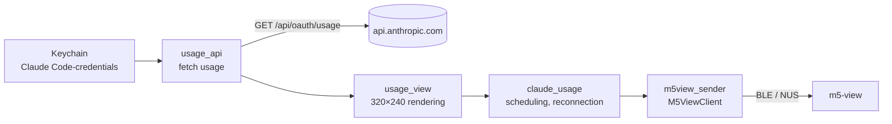
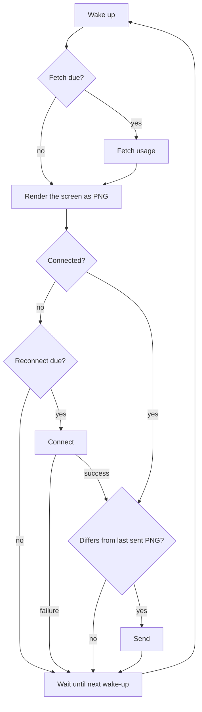

# Claude Usage display tool design

## 1. Overview

A resident macOS tool that renders Claude subscription usage with the same layout as m5-claude-usage (Claude usage display firmware for M5Stack) and sends it to m5-view periodically.



Images are transferred according to the [m5-view protocol](../../../docs/protocol.md) with `M5ViewClient` from the sender package `m5view_sender`.

## 2. Requirements

| Item | Description |
| --- | --- |
| Data | Usage and reset time of the 5-hour (`five_hour`) and 7-day (`seven_day`) windows |
| Authentication | Reads the access token that Claude Code on the Mac stores in the keychain. Claude Code takes care of refreshing it |
| Screen | Same content as m5-claude-usage: a clock in the header, two bars with elapsed markers, a countdown once a limit is reached, dimming when fetching fails, and a status line |
| Fetch interval | 60 seconds (configurable with `--interval`). On failure, doubles from 30 seconds up to 10 minutes |
| Render interval | At second 0 of every minute. Sends only when the image has changed |
| BLE | Keeps the connection open and reconnects every 30 seconds once it drops |

## 3. Source layout

```
tools/claude-usage/
├── pyproject.toml     # Refers to m5-view-sender as a path dependency
├── claude_usage.py    # CLI. Scheduling of fetch, render and send, reconnection
├── usage_api.py       # Keychain access and usage API calls
├── usage_view.py      # Screen rendering
└── tests/
```

## 4. Fetching usage (usage_api)

### 4.1 Access token

- Each fetch runs `security find-generic-password -s "Claude Code-credentials" -w` and uses `claudeAiOauth.accessToken` from the JSON. A token refreshed by Claude Code takes effect from the next fetch
- If `claudeAiOauth.expiresAt` (milliseconds) has passed, the token counts as expired without calling the API
- The tool reads the keychain and leaves it unchanged. The server rotates the refresh token on every use, so a refresh by this tool would invalidate the Claude Code login
- macOS asks for permission on the first read. Choosing "Always Allow" stops further prompts

### 4.2 API

```
GET https://api.anthropic.com/api/oauth/usage
Authorization: Bearer <accessToken>
anthropic-beta: oauth-2025-04-20
User-Agent: claude-code/<version>
```

- The `User-Agent` version comes from `claude --version` at startup, with a fixed fallback
- `utilization` (0-100) and `resets_at` (ISO 8601) are read from `five_hour` / `seven_day` in the response. A `null` window means no data, and a `null` `resets_at` means the reset time is unknown

### 4.3 Errors

| Situation | Status line | Next fetch |
| --- | --- | --- |
| Token expired (`expiresAt` passed, or `401`) | `token expired - run Claude Code` | Normal interval |
| Other HTTP errors | `HTTP <code> - retry in <n>s` | Doubles from 30 seconds, up to 10 minutes |
| Network errors | `network error - retry in <n>s` | Same as above |
| No keychain item | `no Claude Code login in keychain - retry in <n>s` | Same as above |
| Unexpected keychain data or response | `unexpected keychain data` / `invalid response` and so on | Same as above |

On failure, the last values stay on screen, dimmed.

## 5. Rendering (usage_view)

Reproduces the layout and colors of `UsageView` in m5-claude-usage with Pillow.

- The screen is 320×240. The font is macOS Helvetica (`/System/Library/Fonts/Helvetica.ttc`) at sizes matching M5GFX FreeSans 9pt / 12pt / 18pt
- Header: title and current time (`HH:MM`)
- Bars: usage of 5h and 7d, colored by usage, with a marker for the elapsed part of the window and the time until reset
- Countdown: replaces the bars while either window is at its limit. It targets the limited window that resets last, and shows a remaining-time ring and numbers
- When the values are stale (the last fetch failed), the bars and ring turn gray
- Status line: `Loading...` (before the first fetch), `Updated HH:MM`, or an error

## 6. Scheduling (claude_usage)

A single loop fetches, renders, connects and sends.



- The wake-up time is the earliest of second 0 of the next minute, the next fetch time, and the next reconnect time while disconnected
- The next fetch time is when the fetch started plus the fetch interval (or the retry interval on failure). A 1-second tolerance lets a fetch happen in the same wake-up even if it drifts slightly from the per-minute wake-up
- On disconnection, the tool forgets the last PNG sent. A restart clears the m5-view screen, so the tool always resends after reconnecting
- Fetching and rendering continue regardless of the BLE state
- Ctrl+C disconnects and exits

## 7. CLI

```
uv run claude_usage.py [--name PREFIX] [--address ADDRESS] [--interval SEC] [--once] [--save PATH]
```

| Option | Default | Description |
| --- | --- | --- |
| `--name` | `M5-View` | Find the device by name prefix |
| `--address` | - | Connect to this device (a CoreBluetooth UUID on macOS) |
| `--interval` | `60` | Seconds between usage fetches |
| `--once` | - | Fetch and send once, then exit. Exit code `1` if connecting or sending fails |
| `--save` | - | Also write the rendered PNG to a file |

Logs go to standard error.

## 8. Testing

| Target | Method |
| --- | --- |
| `usage_api` | Unit tests with `pytest` (credential parsing, expiry check, response parsing) |
| `usage_view` | Unit tests with `pytest` (countdown target selection, time formats, elapsed fraction, view switching, dimming) |
| `claude_usage` | Unit tests with `pytest` (retry interval, wake-up time) |
| Keychain, API, BLE | Manual tests on real hardware |
